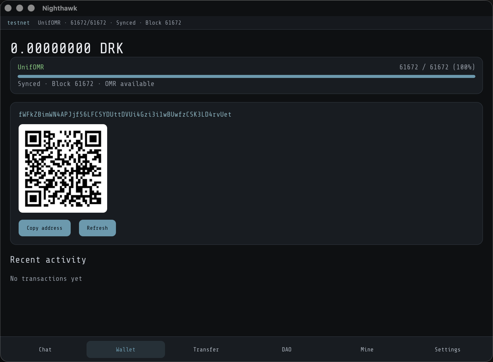

# Nighthawk Desktop

<p align="center">
  
</p>

**3.00.025** (crate / Tauri semver **3.0.25** — leading zeros are not valid Cargo/Tauri versions). Same version as the Android and iOS apps. Send waits until the wallet is spend-ready, the sync label is green only while lightwalletd is live, and the UI uses the Android type scale (Source Sans 3, Outfit, IBM Plex Mono). Cross-platform DarkFi wallet for desktop ([`nighthawk-apps/nighthawk-desktop`](https://github.com/nighthawk-apps/nighthawk-desktop)):

- **Lit** UI (Chat · Wallet · Transfer · **Mine** · Settings)
- **Tauri 2** Rust host
- Same **`darkfi-mobile-ffi`** UniFFI crate as Android (tip `drk` turso/aegis256 wallet, UnifOMR sync, DarkIRC, send/receive). Sent-tx session cache is FIFO-capped (10,000; updates do not refresh eviction). Reorg UI `txs_affected` is the wallet history row count (`block_height > rewind`), not CLI log-line length.
- **Instant sync & checkpoints:** authenticated `TreeState` restore, real birthday clamping, UnifOMR pipelining, and ZKAS caching (see [docs/instant-sync-strategy.md](docs/instant-sync-strategy.md))
- **Proto version lockstep:** validates lightwalletd `proto_version` (1.x.x) and renders warning banner on protocol mismatches
- Local **vault** (`vault.dat` AES-256-GCM; master key in the **OS keychain** — macOS Keychain / Windows Credential Manager / Linux Secret Service). Legacy v2 vaults used a static PBKDF2 constant. **No app PIN**; the wallet opens automatically. Treat the data directory as sensitive.
- Separate data dirs per **testnet / mainnet**, plus optional **multi-wallet** profiles
- Product surface: tokens, memos, DAO, Arti Tor, DarkIRC E2E DM, address book
- Bundled **xmrig** only. The Mine tab refuses a binary whose SHA-256 is not a shipped Nighthawk build, and it no longer falls back to a system `xmrig`. Stratum and other remote endpoints reject private and link-local hosts; loopback stays allowed for a local darkfid
- Wallet, chat, and vault commands run against the wallet that is open in the app, not a process-global handle
- **Tor on by default** for remote lightwalletd / chat (embedded Arti). Default testnet LWD is loopback `http://127.0.0.1:9067`; switch URL in Settings for a remote pin.
- **Strict UnifOMR sync (default on):** only payments with UnifOMR clues are discovered. Turn it off in Settings to trial-decrypt compact blocks and receive from non-UnifOMR wallets (e.g. upstream `drk`, Moonshine `--no-omr`).
- **Localnet (2026-10-21):** 100/100 UnifOMR sends each way with Moonshine and with Android. Ten Moonshine `--no-omr` payments trial-decrypted (`E2E_FORCE_TRIAL=1`); the balance stayed put across eight further syncs. iOS was not in that run. Desktop finished at 2.5958 DRK, which is not enough for another 100-send pair (6.42 DRK if change is recovered).
- UnifOMR Param2 limits: [`docs/unifomr_mvp_limits.md`](docs/unifomr_mvp_limits.md)

## Prerequisites

- Rust toolchain, Node 20+, `pnpm`
- macOS: Xcode CLT (for local macOS builds)
- Reachable **darkfi-lightwalletd** (default testnet: `http://127.0.0.1:9067`; remote HTTPS still needs a TLS pin)
- **Sibling directory literally named `nighthawk-android-wallet`** (Cargo path-depends on `../../nighthawk-android-wallet/rust/darkfi-mobile-ffi`).
- For mining: **darkfid** with stratum (`:18347` testnet / `:8347` mainnet)

## Repository layout

Path dependencies use **sibling directory names** (see `src-tauri/Cargo.toml`):

```text
parent/
  darkfi/                          # do not clone git.dark.fi (HTTP 504). FFI uses Android third_party
  darkfi-nighthawk-testnet/        # symlink to nighthawk-android-wallet/third_party/darkfi
  darkfi-lightwalletd/             # lightwalletd + UnifOMR reference
  nighthawk-android-wallet/        # provides rust/darkfi-mobile-ffi (required)
  nighthawk-desktop/               # this repo
  # optional:
  nighthawk-ios-wallet/
  moonshine/
```

`src-tauri/Cargo.toml` path-depends on:

```text
../../nighthawk-android-wallet/rust/darkfi-mobile-ffi
```

Do **not** point at a `darkfi-mobile-ffi` symlink at the GitHub root — Cargo resolves the FFI crate’s relative `third_party/darkfi` from the real Android tree path.

`src-tauri/Cargo.lock` is committed so release builds stay reproducible.

## Develop

```bash
cd nighthawk-desktop
pnpm install
# Optional if the default cargo git cache is not writable:
#   export CARGO_HOME=$HOME/.cargo-nh
pnpm tauri dev
```

## Build

`src-tauri/Cargo.toml` requires a sibling **`nighthawk-android-wallet`**.

Cargo git deps inside that tree are not fetched from `git.dark.fi` (HTTP 504):

| Crate | URL |
|-------|-----|
| `kvdb-overlay` `accd2689` | `https://gitlab.com/nighthawk24/kvdb-overlay` |
| RandomX `0e31d5a` | `https://codeberg.org/darkrenaissance/RandomX` |
| `rust-url` branch `v258` | `https://github.com/darkrenaissance/rust-url` |

```bash
# Dev / compile the .app only (skips Finder/AppleScript DMG layout):
CI=true pnpm tauri build

# Or skip the DMG bundle:
pnpm tauri build --bundles app
```

Without `CI=true`, `bundle_dmg.sh` fails in non-GUI / agent shells (it drives Finder via AppleScript). The binary and `.app` still compile; only the DMG step needs a real Finder session or `CI=true`.

Host checks after Android FFI changes (this app path-depends on `nighthawk-android-wallet/rust/darkfi-mobile-ffi`):

```bash
cd src-tauri
cargo test --release
cargo build --release
```

## xmrig sidecar

Place platform binaries under `src-tauri/binaries/` named for Tauri externals:

- `xmrig-aarch64-apple-darwin`
- `xmrig-x86_64-apple-darwin`
- `xmrig-x86_64-unknown-linux-gnu`
- `xmrig-x86_64-pc-windows-msvc.exe`

The app checks the file against the SHA-256 allowlist in `src-tauri/src/commands.rs` before it starts. A Homebrew or other system `xmrig` is not used.

```bash
./scripts/fetch-xmrig.sh
```

## Data paths (macOS)

`~/Library/Application Support/nighthawk-app-desktop/`

- `prefs.json`
- `{testnet,mainnet}/wallet.db` (turso + experimental aegis256; wipe after DarkFi pin bumps that change wallet format)
- `{testnet,mainnet}/cache/`
- `{testnet,mainnet}/darkirc_db/`
- Local vault: `vault.meta.json` + `vault.dat` (AES-256-GCM; master key in OS keychain, **not** a user PIN)

## Privacy / Tor

`use_tor` defaults to **true**. Remote lightwalletd and DarkIRC exit via Arti SOCKS. Disable Tor in Settings only for loopback/dev testing.

Changing LWD URL, TLS pin, Tor, or network closes the open wallet handle — reopen the wallet after Save.

## Mine tab

Unlock wallet → Mine → set threads → Start. Payouts go to `primary_deposit_address`. Stratum URL is editable in Settings.

## Known issues

1. Strict UnifOMR is the default. Clue-less payments (Moonshine `--no-omr`, upstream `drk`) stay invisible until strict mode is turned off. Forcing trial while strict mode is still on used to idle the scan cursor; trial now clears strict mode first, and a `GetBlockRange` hole does not mark missing blocks scanned.
2. The 2026-10-21 localnet did not include iOS. This desktop build shares the Android UniFFI crate, so the trial-cursor fixes apply here after that crate is rebuilt.
3. `git.dark.fi` returns HTTP 504. Do not clone DarkFi or its git deps from there. Use the Android `third_party/darkfi` pin and the GitLab / Codeberg / GitHub mirrors listed under Build.
