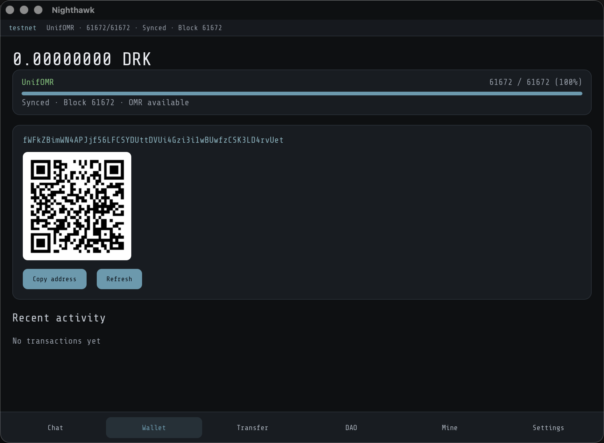

# Nighthawk Desktop

<p align="center">
  
</p>

**3.2.1** (crate / Tauri / `package.json`; same release as Android 3.2.01). Switches FFI backend to standalone MIT [`blackhawk`](https://github.com/nighthawk-apps/blackhawk) (`0.3.0`), adds optional DarkIRC Double Ratchet (`NHDR1:` / `&dr=1`), persistent Disable Direct Connections setting, and a lightweight `FlowSyncWave` sync indicator. DarkFi pin `b87318e80` via shared `blackhawk`. Aligns with Android 3.2.01, Moonshine 3.2.1, lightwalletd 0.3.15, and iOS 3.01.24 (pending 3.2.01). Cyberpunk is the default theme on a light or dark system, with the Void wallpaper anchored at the top left. Body text uses DejaVu Sans Mono. Send waits until the wallet is spend-ready, the sync label is green only while lightwalletd is live, and Paper uses the same graphite and grey accent scale as Android and iOS Light. Type is the Android scale (Source Sans 3, Outfit, IBM Plex Mono). Cross-platform DarkFi wallet for desktop ([`nighthawk-apps/nighthawk-desktop`](https://github.com/nighthawk-apps/nighthawk-desktop)):

## Executive Summary: Why Nighthawk Leads in Privacy

Nighthawk is engineered as a full-stack private money and communications client with zero transparent escape hatches:

- **Shielded-only ZK base layer (DarkFi Halo2):** Every transfer, custom token mint/send, and DAO governance action is shielded inside Halo2 zero-knowledge proofs against the global Merkle tree. Unlike Zcash, there are no transparent `t-addr` pools, no multi-pool value splits, and no TEX-style forced deshielding; unlike Monero (pre-FCMP++), anonymity sets are not limited to finite decoy ring signatures; unlike Namada/Penumbra/Pirate Chain, full-stack privacy spans wallet, DAO governance, and encrypted P2P chat.
- **Network-layer privacy on by default:** Desktop defaults to embedded **Arti (Tor)** (and supports **Nym mixnet** switching) with fail-closed leaf TLS pinning and private/link-local stratum host rejection; **Settings → Advanced** provides a persistent **Disable Direct Connection** lock.
- **Private light-client sync:** Padded trial decryption runs by default over Tor/Nym, paired with opt-in **UnifOMR (Param2, ePrint 2026/910) + batch PIR** using power-of-2 padded windows, decoy clue directories with ≥250 ms timing padding, and fail-closed full-window fallback.
- **Integrated encrypted P2P chat & vault hardening:** DarkIRC runs in-process over Tor `.onion` or Nym with `ChaChaBox` DM encryption plus Nighthawk's **wallet-level Double Ratchet** (`NHDR1:`) for per-message forward secrecy, and an OS-keychain-backed AES-256-GCM vault + encrypted address book.

- **Lit** UI (Chat · Wallet · DEX · **DAO** · Mine · Settings). Wallet actions are **Request · Receive · Send**.
- **Tauri 2** Rust host
- Same **`blackhawk`** UniFFI crate as Android and iOS (upstream `drk` transfer, trial-decrypt sync, DarkIRC, send/receive). Sent-tx session cache is FIFO-capped (10,000; updates do not refresh eviction). Reorg UI `txs_affected` is the wallet history row count (`block_height > rewind`), not CLI log-line length.
- **Instant sync & checkpoints:** authenticated `TreeState` restore, real birthday clamping, UnifOMR pipelining, and ZKAS caching (see [docs/instant-sync-strategy.md](docs/instant-sync-strategy.md))
- **Proto version lockstep:** the shared Android FFI expects lightwalletd proto **2.1.0**. A major mismatch sets `protoVersionMismatch` and the wallet screen shows a warning banner. DarkFi pin `b87318e80` pays fees from tx-local change when that output covers the fee
- Local **vault** (`vault.dat` AES-256-GCM; master key in the **OS keychain** — macOS Keychain / Windows Credential Manager / Linux Secret Service) and keychain-backed encrypted **address book** (`address_book.db`; fails closed without plaintext disk fallback and preserves exact-case Base58 addresses). **Auto-unlock / no app PIN** on desktop is an intentional design decision; treat the desktop user account and OS keychain as the unlock boundary.
- Separate data dirs per **testnet / mainnet**, plus optional **multi-wallet** profiles
- Product surface: tokens, memos, DAO, Arti Tor, DarkIRC E2E DM (with in-memory FFI DM contact registration via `register_dm_contact` / `clear_dm_contacts`, keeping DM keys out of plaintext SQLite), address book, and verified in-chat payment receipts (`CHAT_RECEIPT_EVENT`); light-sync polls continuously from the `main-app` shell across tabs, and **Send** displays **Broadcasted** only after lightwalletd confirms the transaction in the mempool
- Bundled **xmrig** only. The Mine tab refuses a binary whose SHA-256 is not a shipped Nighthawk build, and it no longer falls back to a system `xmrig`. Stratum and other remote endpoints reject private and link-local hosts; loopback stays allowed for a local darkfid
- Wallet, chat, and vault commands run against the wallet that is open in the app, not a process-global handle
- **Tor on by default** on desktop for remote lightwalletd / chat (embedded Arti). Default testnet LWD is Mac Studio ngrok TLS `https://epidermis-sandbox-marshland.ngrok-free.dev` with pinned leaf SHA-256 `d8163009e3bb0bac39adbbfeb227827a91a590b96ec33f72576278c492be628e`; switch URL/pin in Settings or run loopback `http://127.0.0.1:9067`.
- **Trial decryption is the default.** Money notes, token mints, and compact DAO calls sync without a clue. Experimental UnifOMR is off in Settings. Turn it on only when both wallets are registered on the same lightwalletd. It is not maintained until DarkFi mainnet contracts are live. Embedded Tor is Arti 0.48.
- UnifOMR Param2 limits: [`docs/unifomr_mvp_limits.md`](docs/unifomr_mvp_limits.md)

## Prerequisites

- Rust toolchain (stable)
- Node.js 20+ and `pnpm` (on macOS: `brew install node pnpm`)
- macOS: Xcode 15+ / Command Line Tools (with `DEVELOPER_DIR=/Applications/Xcode.app/Contents/Developer` if needed)
- Sibling directory literally named `blackhawk` (provides `crates/blackhawk` and `crates/blackhawk-unifomr`)
- Sibling directory `darkfi-nighthawk-testnet` (via `git -C ../darkfi worktree add --detach ../darkfi-nighthawk-testnet origin/nighthawk-testnet` or symlink)
- Reachable **darkfi-lightwalletd** (default testnet uses `https://epidermis-sandbox-marshland.ngrok-free.dev` with pinned leaf SHA-256 `d8163009e3bb0bac39adbbfeb227827a91a590b96ec33f72576278c492be628e`; custom remote HTTPS endpoints require a TLS pin, or use loopback `http://127.0.0.1:9067`)
- For mining: **darkfid** with stratum (`:18347` testnet / `:8347` mainnet)

## Repository layout

Path dependencies use **sibling directory names** (see `src-tauri/Cargo.toml`):

```text
parent/
  darkfi/                          # do not clone git.dark.fi (HTTP 504)
  darkfi-nighthawk-testnet/        # pin b87318e80 (or symlink to nighthawk-android-wallet/third_party/darkfi)
  darkfi-lightwalletd/             # lightwalletd + UnifOMR server
  blackhawk/                       # Nighthawk's standalone FFI + UnifOMR core (required)
  nighthawk-desktop/               # this repo
  # optional:
  nighthawk-android-wallet/
  nighthawk-ios-wallet/
  moonshine/
```

`src-tauri/Cargo.toml` path-depends on:

```text
../../blackhawk/crates/blackhawk
```

`src-tauri/Cargo.lock` is committed so release builds stay reproducible.

## Develop

```bash
cd nighthawk-desktop
pnpm install
# Optional if the default cargo git cache is not writable:
#   export CARGO_HOME=$HOME/.cargo-nh
pnpm tauri dev
```

## Build

`src-tauri/Cargo.toml` requires a sibling **`blackhawk`** and **`darkfi-nighthawk-testnet`**.

Cargo git deps inside that tree are not fetched from `git.dark.fi` (HTTP 504):

| Crate | URL |
|-------|-----|
| `kvdb-overlay` `accd2689` | `https://gitlab.com/nighthawk24/kvdb-overlay` |
| RandomX `0e31d5a` | `https://codeberg.org/darkrenaissance/RandomX` |
| `rust-url` branch `v258` | `https://github.com/darkrenaissance/rust-url` |

```bash
# Dev / compile the .app only (skips Finder/AppleScript DMG layout):
CI=true pnpm tauri build

# Or skip the DMG bundle:
pnpm tauri build --bundles app
```

Without `CI=true`, `bundle_dmg.sh` fails in non-GUI / agent shells (it drives Finder via AppleScript). The binary and `.app` still compile; only the DMG step needs a real Finder session or `CI=true`.

Host checks after `blackhawk` FFI changes (this app path-depends on `../blackhawk/crates/blackhawk`):

```bash
cd src-tauri
cargo test --release
cargo build --release
```

## xmrig sidecar

Place platform binaries under `src-tauri/binaries/` named for Tauri externals:

- `xmrig-aarch64-apple-darwin`
- `xmrig-x86_64-apple-darwin`
- `xmrig-x86_64-unknown-linux-gnu`
- `xmrig-x86_64-pc-windows-msvc.exe`

The app checks the file against the SHA-256 allowlist in `src-tauri/src/commands/mining.rs` before it starts. A Homebrew or other system `xmrig` is not used.

```bash
./scripts/fetch-xmrig.sh
```

## Data paths (macOS)

`~/Library/Application Support/nighthawk-app-desktop/`

- `prefs.json`
- `{testnet,mainnet}/wallet.db` (turso + experimental aegis256; wipe after DarkFi pin bumps that change wallet format)
- `{testnet,mainnet}/cache/`
- `{testnet,mainnet}/darkirc_db/`
- Local vault: `vault.meta.json` + `vault.dat` (AES-256-GCM; master key in OS keychain, **not** a user PIN)

## Privacy / Tor

`use_tor` defaults to **true**. Remote lightwalletd and DarkIRC exit via Arti SOCKS. Disable Tor in Settings only for loopback/dev testing.

Changing LWD URL, TLS pin, Tor, or network closes the open wallet handle — reopen the wallet after Save.

## Mine tab

Unlock wallet → Mine → set threads → Start. Payouts go to `primary_deposit_address`. Stratum URL is editable in Settings.

## Windows runtime notes

Nighthawk Desktop only invokes outbound client paths in `blackhawk` (gRPC lightwallet sync + outbound DarkIRC P2P client). The server-side POSIX `libc::E*` accept loops in upstream `darkfi` (`net/acceptor.rs`, `rpc/server.rs`, and `bin/darkirc/src/irc/server.rs`) are **not reachable** from Desktop. In the outbound TCP dialer (`net/transport/tcp.rs`), non-blocking `connect()` checks both `libc::EINPROGRESS` and `io::ErrorKind::WouldBlock` (which Rust maps from `WSAEWOULDBLOCK` on Windows). The only minor Windows-specific quirk in upstream `darkfi` is `net/connector.rs` checking `libc::ENETUNREACH` rather than `WSAENETUNREACH` for its IPv6-availability cache; on IPv4-only Windows hosts using clearnet Direct mode, IPv6 seed addresses fail cleanly and fall back to IPv4 (Tor and Nym modes dial local IPv4 `127.0.0.1` SOCKS5 proxies directly).

## Known issues

1. Experimental UnifOMR is **off** by default (padded trial decryption). Clue-less payments from upstream `drk` or Moonshine without UnifOMR sync via trial decrypt. Turning UnifOMR on requires both wallets registered on the same lightwalletd.
2. `git.dark.fi` returns HTTP 504. Do not clone DarkFi or its git deps from there. Use the Android `third_party/darkfi` pin (`b87318e80`) and the GitLab / Codeberg / GitHub mirrors listed under Build.
